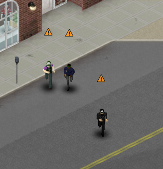
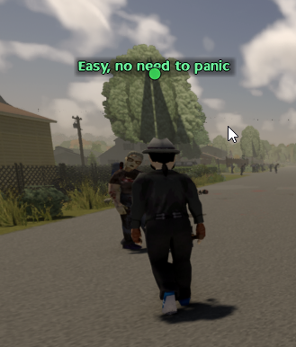
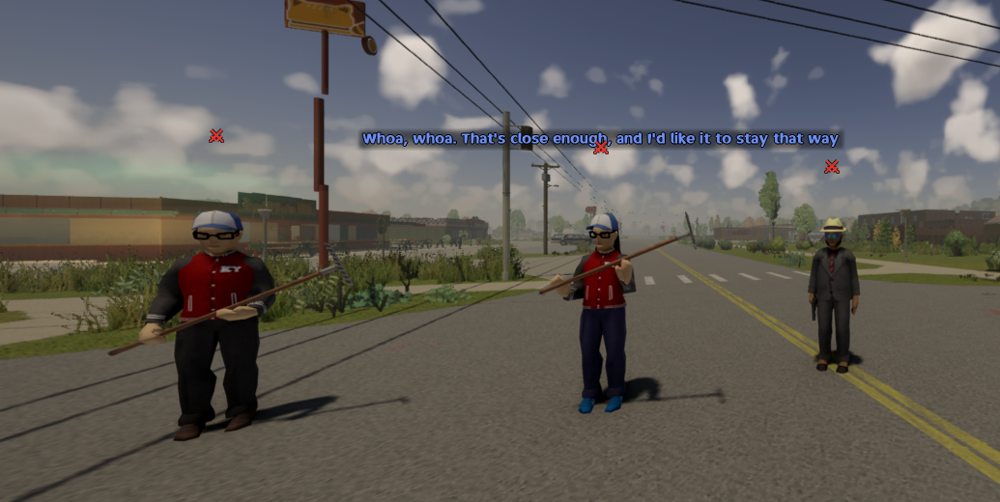
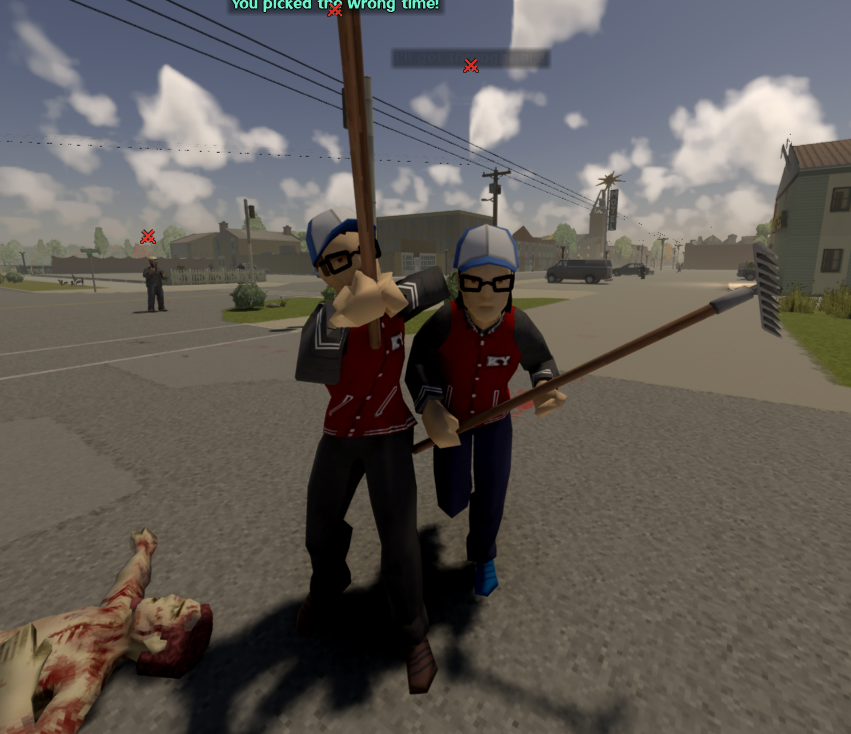
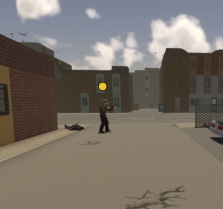
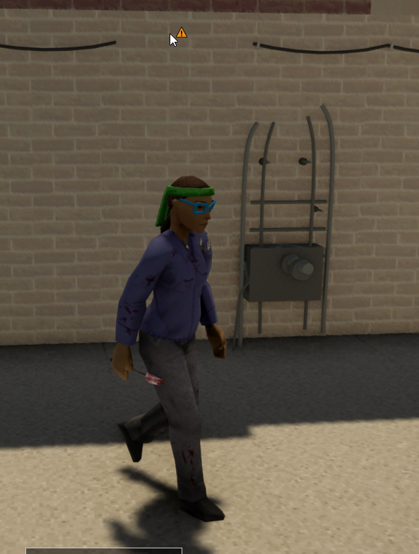
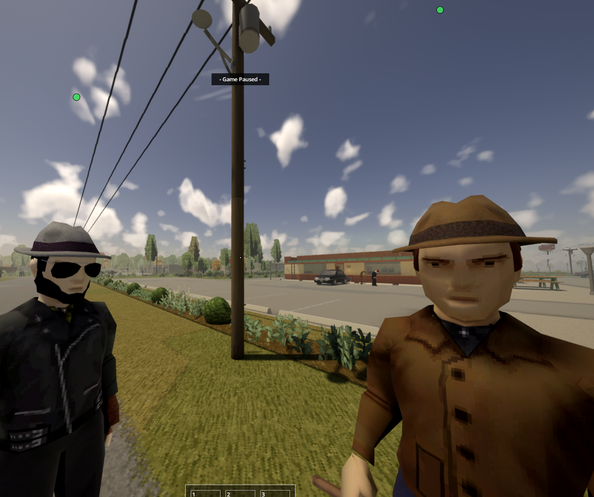

# A-Life Stance Dots

Client-side add-on for **Project A-Life [ALIFE NPCS]** (Workshop `3803984183`, mod id `ProjectALifeNPCs`).
Draws an icon over every A-Life NPC's head. Red is **only** for people who
will attack you.

| Icon | Status | Meaning |
| --- | --- | --- |
| red crossed swords | `hostile` | hostile to you, or attacking you / your people right now |
| orange warning triangle | `careful` | wary: won't shoot first (A-Life 1.4 fairness), but don't push it |
| yellow dot | `neutral` | leaves you alone unless provoked |
| green dot | `friendly` | will not attack you |
| green shield | `allied` | allied faction, or an allied crew (Jeem standing) |
| blue star | `companion` | in your party, walking with you, or an allied crew following you |
| blue house | `resident` | lives at a base you manage (Jeem residents) |

## Screenshots

| | |
| --- | --- |
|  |  |
| Isometric: wary (orange) survivors crossing the street | Third person ([Project Viewpoint](#project-viewpoint-first--third-person)): a friendly survivor talking |
|  |  |
| First person: a hostile group calling out a warning | First person: the same raiders attacking |
|  |  |
| First person: neutral (yellow) survivor with a gun | 3D view: a wary (orange) survivor up close |



Priority, first hit wins: hostile → companion → resident → allied → stance.
A companion or resident who turns on you goes red.

Works with **Project A-Life 1.4.x** and, optionally, **Project A-Life - Jeem
Extension** (`ProjectALifeJimmy`), which supplies residents, crew allies and
"attacking your people".

## How A-Life distinguishes friendly from hostile

The stance is **per-actor and per-player**, not a property of the spawned
group alone. `ProjectALife.Relations.playerStance(actor, player)` in
`media/lua/server/ProjectALife/Decisions/ALifeRelations.lua` is the authority; it
resolves in this order (first hit wins):

1. `actor.memory.hostileOverride == true` → hostile (admin / scripted force).
2. `actor.memory.hostileToPlayerKeys[playerKey]` → hostile to *that* player only.
3. `Party.friendly` — you joined their group → friendly.
4. Baseline: `actor.memory.spawnStance`, else the faction's word toward players
   via `RelationLayers.towardPlayer` (`relations.player`, profession shifts,
   else `spawn.peaceable` → friendly, otherwise hostile); first contact can
   also seed a personal reputation.
5. `hostileOverride == false` → friendly.
6. Earned reputation (`Reputation.recordedStatus`): hostile always wins;
   friendly / careful / neutral replace the baseline.
7. Timed softeners: `carefulPlayerKeys`, `tolerateUntil`.
8. **Fairness** (`Fairness.stanceFor`): a hostile NPC that may not open fire
   first is reported as `careful`. That is why careful is orange, not red.

Whether an NPC will actually shoot is `Relations.hostileToPlayer` (truces,
robberies, standoffs, fairness, grudges, ordered hunts). This mod paints red
when either says hostile, or when the NPC is in combat targeting you.

NPC-vs-NPC hostility is a different call, `Relations.status(source, target)`:
same `factionId`, same `groupId`, same `outpostId` or a support link means
friendly; otherwise faction `relations` tables, then bloc rules, then the
`spawn.peaceable` flags on both sides.

### Getting at it from the client

* A-Life NPCs are **zombie shells**, so they are in `getCell():getZombieList()`.
* Each shell carries `ProjectALifeUID` / `ALifeUID`, plus `ProjectALifeFactionId`,
  in its mod data and game variables.
* The actor record for a uid is on the client in
  `ProjectALife.Executor.mirror.records[uid]` (the server streams full records
  and the faction definitions it needs via `ALifeMirrorTransport`), and in
  singleplayer also in `ProjectALife.ActorRegistry.read(uid)`.
* Reputation overrides reach the client as the `reputationSync` server command,
  cached in `ProjectALife.StatusStore.reputation`.

So this mod calls `Relations.playerStance` / `hostileToPlayer` /
`Party.friendly` when they are loaded (singleplayer and host) and falls back to
steps 1, 2, 4–6 from the mirrored record, the shared `RelationLayers`, the
network faction catalog and the reputation sync on a multiplayer client.
Party membership, personal reputation, fairness and timed truces stay
server-side, so on an MP client a party member shows by faction stance and a
"careful" fairness NPC may show red. `walkWith` escorts and Jeem residents /
allies do reach the client.

## Install

Copy `ALifeStanceDots/Contents/mods/ALifeStanceDots` into
`%UserProfile%\Zomboid\mods\`, then enable **A-Life Stance Dots** after
Project A-Life in the mod list. It is client-side only; no server changes needed.
Using Project Viewpoint? Copy `ALifeStanceDotsViewpoint` too (see below).

Testing a local build: the game also loads mods from
`%UserProfile%\Zomboid\Workshop\<item>\Contents\mods\`, and a stale copy there
with the same mod id can win over `Zomboid\mods\`. Keep both in sync, and
unsubscribe from the Workshop item while testing.

## Project Viewpoint (first / third person)

[Project Viewpoint](https://steamcommunity.com/sharedfiles/filedetails/?id=3809306528)
draws the world in 3D, so the isometric projection puts icons in the wrong
place. Enable the extra mod **A-Life Stance Dots - Viewpoint**
(`ALifeStanceDotsViewpoint`, shipped in the same Workshop item) alongside
Viewpoint and ZombieBuddy. In first or third person it places each icon with
Viewpoint's own camera; in the isometric view nothing changes.

It carries a small Java bridge (`media/java/client/ALifeStanceDotsViewpoint.jar`,
source in `42/src/`) because Viewpoint does not expose its world-to-screen
projection to Lua; it is exposed to Lua as the class `ALifeStanceDotsViewpoint`
(`pixel(x, y, z, metres)`, `pixelX()`, `pixelY()`). ZombieBuddy 2.3.0+ asks you
to approve the jar the first time, and again whenever it changes.
The bridge reads Viewpoint internals (checked against Viewpoint 0.1.6.1); if a
Viewpoint update renames them the icons hide in 3D and `console.txt` says
`[ALifeStanceDots] Viewpoint camera not found`. If the jar is not loaded at all
the icons also hide in 3D (never drawn in the wrong place) and the log says
`Java bridge is not loaded`.

**Simple Viewpoint Lock** removes the isometric view entirely (single player
included); disable it if you want to switch back with **O**.

Rebuild the jar (no JDK needed, uses the game's Java and the Eclipse compiler):

```
ECJ=/path/to/ecj-3.46.100.jar sh tools/build_viewpoint_jar.sh
```

## Options

Sandbox options, page **A-Life Stance Dots** (new game, or Admin → Sandbox
Options on a running server; synced to every client):

| Option | Default | Notes |
| --- | --- | --- |
| Marker style | Icons | **Dots**: one colour per status (allied dark green, resident light blue). **Icons**: the shapes above |
| Marker height (tiles) | `1.15` | 0.5–3.0 above the NPC's feet |

## Tuning

`ALifeStanceDots.settings` in
`42/media/lua/client/ALifeStanceDots/ALifeStanceDots.lua`:

| Key | Default | Notes |
| --- | --- | --- |
| `icons` | `true` | fallback when the sandbox option is absent |
| `headHeight` | `1.15` | fallback when the sandbox option is absent |
| `size` | `16` | icon size in UI pixels |
| `alpha` | `0.9` | |
| `range` | `30` | tiles from the player |
| `requireVisible` | `true` | hide icons for NPCs behind walls |
| `cacheMs` | `500` | how long one NPC's status is reused |

Icons are generated by `python tools/make_icons.py` (Pillow). The Workshop
preview is built from Project A-Life's own icon by `python tools/make_preview.py`
(Pillow + Windows' Bahnschrift font) and is marked [UNOFFICIAL].

## Test

```
lua tests/stance_spec.lua
```

No Lua on the box? `python -c "import lupa; lupa.LuaRuntime().execute(open('tests/stance_spec.lua').read())"`,
or LuaJ on the game's Java: `java -cp luaj-jse-3.0.1.jar lua tests/stance_spec.lua`.
Stubs the A-Life / Jeem globals and checks the status priority order and the
Viewpoint projection switch.
